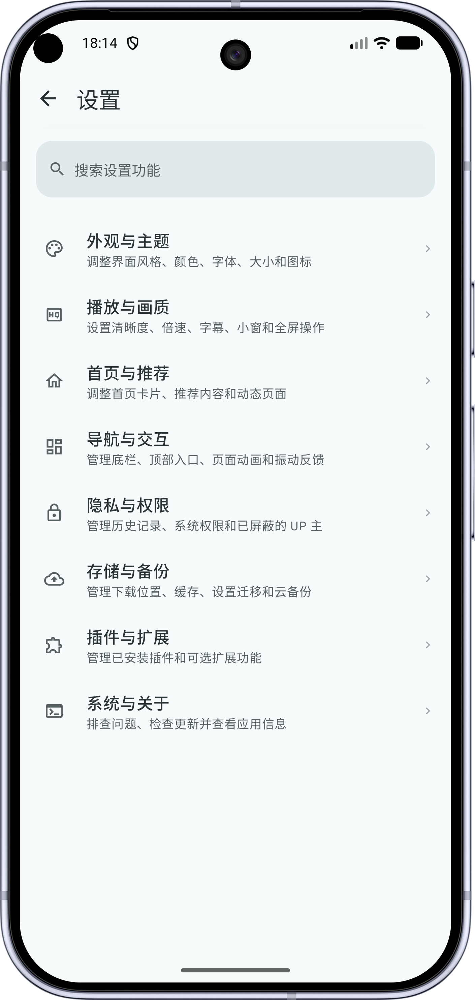
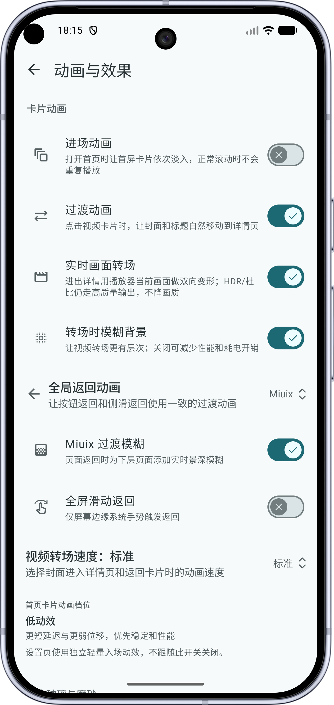
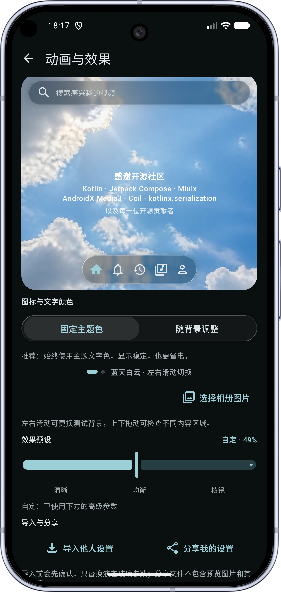
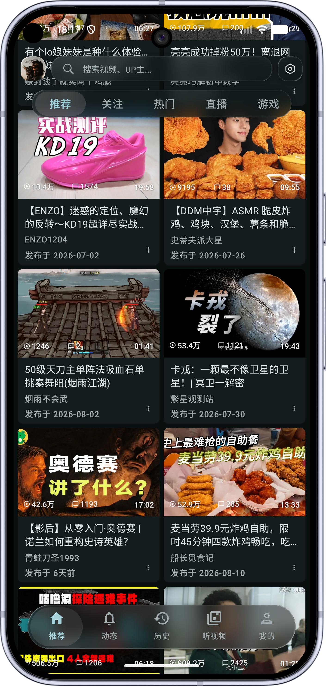
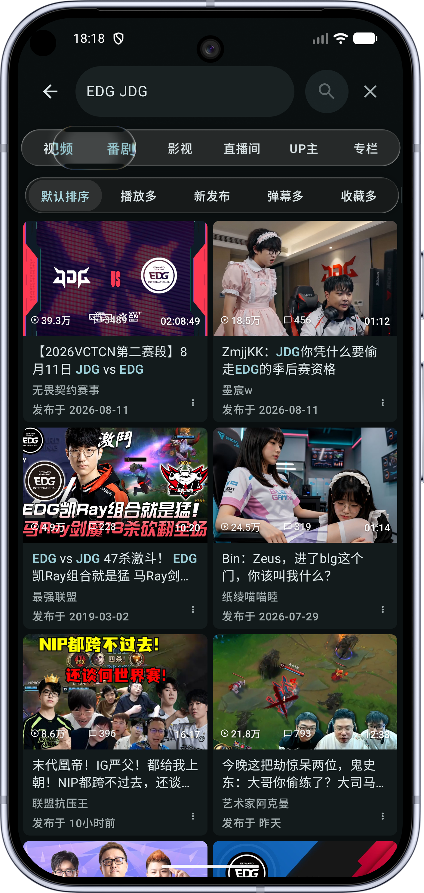
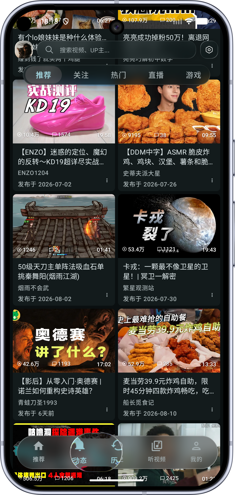

<div align="center">


# BiliPai

**A native, clean and extensible BiliBili client for Android**

[简体中文](README.md) · [English](README_EN.md)


[Telegram channel](https://t.me/bilipai666) · [Telegram group](https://t.me/bilipai888/1) · [X](https://x.com/YangY_0x00)

<sub>Source version 0.5.4 (502) · Updated 2026-10-22</sub>

</div>

Built with Kotlin and Jetpack Compose, BiliPai supports videos, bangumi, live streams, feeds, messages and offline downloads. It adapts to phones, tablets and foldables, with a separate TV app.

[Download](#download) · [Features](#features) · [Preview](#preview) · [Build](#build) · [Changelog](CHANGELOG.md)

## Features

| Feature | Details |
| --- | --- |
| Playback | DASH, HD quality, danmaku, gestures, speed controls, resume, background play and picture-in-picture |
| Audio mode | Immersive and vinyl layouts, lyrics, queues, sleep timer and system media controls |
| Subtitles and notes | Local subtitle import/export, styling and timing; private notes, timestamps and AI-summary drafts |
| Bangumi and live | Following, episode selection, seek previews, live categories and danmaku |
| Feeds and messages | Followed creators, comments, replies, image previews and direct messages |
| Search and downloads | Video, creator and bangumi search; resumable downloads and local playback |
| Appearance | Material 3, Miuix, optional Liquid Glass, dynamic colors and large-screen layouts |
| Extensions | Plugins, DLNA / Google Cast and WebDAV settings backup |

Some quality tiers require login or account privileges. Appearance, playback, danmaku and background behavior are configurable in Settings.

## Preview

Appearance varies by version, theme and screen size.

<div align="center">











</div>

## Download

Get APKs and release notes from the [Telegram channel](https://t.me/bilipai666). Join the [Telegram group](https://t.me/bilipai888/1) for feedback.

- Requires Android 8.0+; supported architectures depend on the APK.
- Sign in with a TV QR code, password, SMS code or imported cookies.
- Allow installation from the source used to open the APK.

## Plugins

The 12 built-in plugins cover sponsor skipping, ad filtering, Anime4K, danmaku, eye care, recommendations and casting. Import JSON / `.bp` rules by URL. Source plugins require compilation; external `.bpplugin` packages currently support preview, saving and authorization records only, without loading or executing external code.

- `plugin-sdk` is the single source of execution contracts and shared models. The app's `BuiltinPlugin` adds presentation and settings UI only; `PluginManager` owns registration, capability queries and enable/disable transitions.
- `PlayerPluginApi.createSession()` creates independent state for each player and video. Feed and recommendation capabilities accept the host's video objects through generics. Danmaku style colors are ARGB integers, with `null` meaning unspecified.
- This is a source-breaking change to `0.1.0-SNAPSHOT`: plugin authors must migrate the base interface, player sessions and recommendation generics, then recompile. No aliases retain the former host contracts. Standalone SDK examples are in `plugins/samples/watch-compass` and `plugins/samples/today-watch-remix`; both use the local SDK and match the main project's AGP 9.3.2 / Kotlin 2.4.0 toolchain.

Review the source and declared permissions before importing third-party plugins.

## Recent updates

- Added English support, local subtitle import/export and styling.
- Improved player menus, bangumi seek previews and paid-content badges.
- Fixed favorites multi-selection, unified profile/sidebar icons and added startup and interaction profiles.

See [CHANGELOG.md](CHANGELOG.md) for details. The source version is defined in `app/build.gradle.kts`.

## Project structure

```text
BiliPai/
├── app/                     # Phone and tablet app
├── app-tv/                  # TV app
├── core-data/               # Networking, data and storage
├── core-player/             # Playback sessions and media
├── design-system/           # Themes and UI components
├── design-tokens/           # Colors, typography and sizing
├── brand-motion/            # Brand assets and motion
├── settings-core/           # Settings policies
├── network-core/            # Network and feed policies
├── plugin-sdk/              # Plugin interfaces
├── plugins/                 # Plugin and skin samples
├── danmaku-engine/          # Danmaku engine
├── dolby-ffmpeg-decoder/    # Audio decoder extension
├── miuix-navigation/        # Navigation components
├── baselineprofile/         # Startup and interaction profiles
├── ci-lint/                 # Static analysis rules
├── build-logic/             # Build plugins
├── gradle/                  # Dependencies and Gradle Wrapper
├── scripts/                 # Build and maintenance scripts
└── docs/                    # Screenshots and source notices
```

## Build

Use JDK 21 and Android SDK 37. The repository manages Gradle Wrapper and dependency versions.

Miuix dependencies require GitHub Packages access. Set `gpr.user` and `gpr.key` in your local `~/.gradle/gradle.properties`, or use `GITHUB_ACTOR` and `GITHUB_TOKEN`. Credentials need read access to the package.

```bash
git clone https://github.com/jay3-yy/BiliPai.git
cd BiliPai
./gradlew :app:assembleDev
```

APKs are exported to `app/build/outputs/bilipai/dev/` or `app/build/outputs/bilipai/release/`.

`app/google-services.json` is optional; Firebase is skipped when absent. Main libraries include Compose, Media3, Room, DataStore, Retrofit, OkHttp and Coil.

## Contributing

Share bugs and ideas through [Issues](https://github.com/jay3-yy/BiliPai/issues/new/choose), or help improve features and translations with a [pull request](https://github.com/jay3-yy/BiliPai/pulls).

## Acknowledgements

| Project | Use |
| --- | --- |
| [Jetpack Compose](https://developer.android.com/jetpack/compose) | UI framework |
| [AndroidX Media](https://github.com/androidx/media) | Media3 / ExoPlayer |
| [DanmakuRenderEngine](https://github.com/bytedance/DanmakuRenderEngine) | Danmaku rendering |
| [BiliBili-API-collect](https://github.com/SocialSisterYi/bilibili-API-collect) | BiliBili API reference |
| [PiliPlus](https://github.com/bggRGjQaUbCoE/PiliPlus) | Playback and mobile UX reference |
| [Bili Pilot](https://github.com/siwei-yuan/bili-pilot) | CDN routing and prefetch reference |
| [BiliBiliSponsorBlock](https://github.com/hanydd/BilibiliSponsorBlock) | Sponsor-skip data and API |
| [Haze](https://github.com/chrisbanes/haze) | Blur effects |
| [Compose Cupertino](https://github.com/alexzhirkevich/compose-cupertino) | Cupertino components |
| [Miuix](https://github.com/compose-miuix-ui/miuix) | UI components and liquid-glass motion reference |
| [BiliPai-miuix](https://github.com/Piracola/BiliPai-miuix) | UI and design-system contributions (@piracola) |
| [Lottie](https://github.com/airbnb/lottie-android) | Vector animation |
| [Coil](https://github.com/coil-kt/coil) | Image loading |
| [Retrofit](https://github.com/square/retrofit) / [OkHttp](https://github.com/square/okhttp) | Networking |
| [Room](https://developer.android.com/training/data-storage/room) / [DataStore](https://developer.android.com/topic/libraries/architecture/datastore) | Local data and preferences |
| [TabulaBili](https://github.com/wangdaodaodao/TabulaBili) / [TabulaBili-Plus](https://github.com/tjsky/TabulaBili) | First-visit recommendation reference |
| [biliSendCommAntifraud](https://github.com/freedom-introvert/biliSendCommAntifraud) | Comment anti-fraud reference |
| [Kotlin](https://kotlinlang.org/) | Programming language |
| [Kotlinx Coroutines](https://github.com/Kotlin/kotlinx.coroutines) | Coroutines and asynchronous tasks |
| [Kotlinx Serialization](https://github.com/Kotlin/kotlinx.serialization) | Data serialization |
| [MaterialKolor](https://github.com/jordond/MaterialKolor) | Dynamic theme colors |
| [Compose Rich Editor](https://github.com/MohamedRejeb/Compose-Rich-Editor) | Rich text editing |
| [ZXing](https://github.com/zxing/zxing) | QR code processing |
| [CameraX](https://developer.android.com/media/camera/camerax) | Camera integration for scanning |
| [WorkManager](https://developer.android.com/topic/libraries/architecture/workmanager) | Background task scheduling |
| [FFmpeg](https://ffmpeg.org/) | Audio decoding |
| [Readability4J](https://github.com/dankito/Readability4J) | Article extraction |
| [jsoup](https://jsoup.org/) | HTML parsing |
| [Telegram](https://github.com/DrKLO/Telegram) | Particle effects and profile interaction reference |

See [third-party notices](THIRD_PARTY_NOTICES.md) for more sources and licenses.

## License and disclaimer

Licensed under [GPLv3](LICENSE). When distributing, provide the corresponding source code and retain copyright notices as required by the license.

This is an unofficial client and is not affiliated with BiliBili. Content belongs to its respective rights holders. Follow applicable laws and platform rules. Login information is stored locally; usage statistics can be managed in Settings.

## Support


<div align="center">

Made by [YangY](https://x.com/YangY_0x00)

</div>
